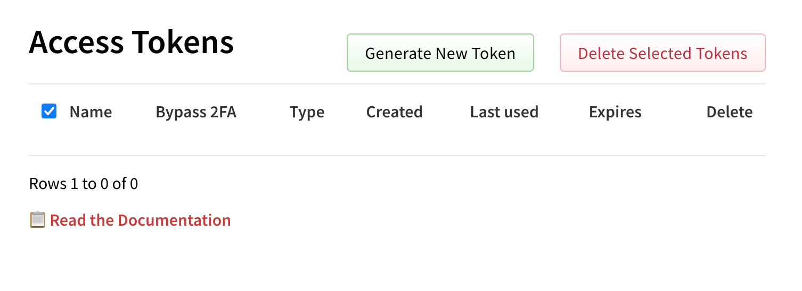

This took a lot of tedious work but I’m now npm token free, weee!

The [@11ty](https://neighborhood.11ty.dev/@11ty) ecosystem is now using Trusted Publishers ([https://docs.npmjs.com/trusted-publishers](https://docs.npmjs.com/trusted-publishers))

