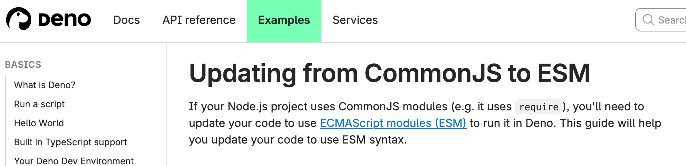
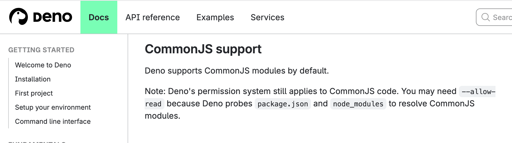

Deno both supports and absolutely does not support CommonJS 😅

1️⃣ [https://docs.deno.com/examples/cjs\_to\_esm\_tutorial/](https://docs.deno.com/examples/cjs_to_esm_tutorial/)  
2️⃣ [https://deno.com/blog/commonjs-is-hurting-javascript](https://deno.com/blog/commonjs-is-hurting-javascript)  
3️⃣ [https://docs.deno.com/runtime/fundamentals/node/#commonjs-support](https://docs.deno.com/runtime/fundamentals/node/#commonjs-support)

 
