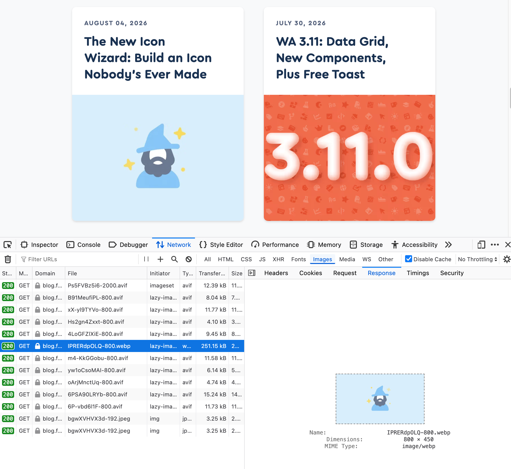

Perf win: blog.fontawesome.com had an animated GIF poster image published recently (for an Aug 4 blog post). Changing the [@11ty](https://neighborhood.11ty.dev/@11ty) Image plugin formats from "avif,auto" to "avif,webp,auto" added an animated WebP to the \<picture> stack and saved 439kB of transfer weight! (nothing else changed) 🏆

