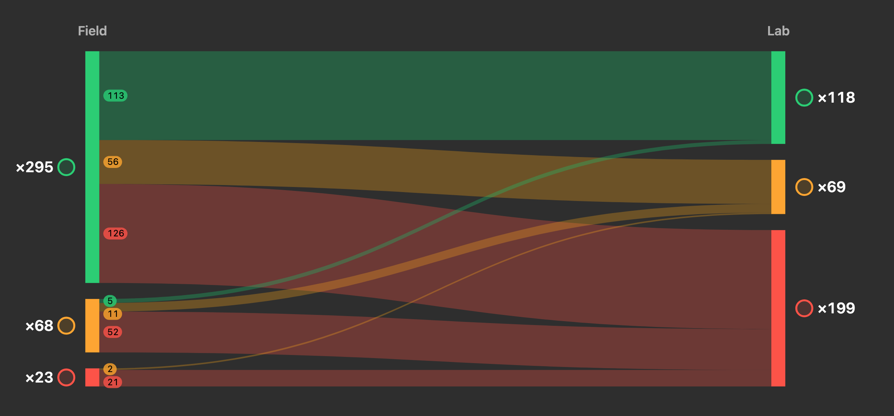

For me this [@speedlify](https://mastodon.social/@speedlify) chart represents how we over-index on field performance data: 61% of sites with good field data have bad lab data 🤡

[https://www.speedlify.dev/charts/#lab-field](https://www.speedlify.dev/charts/#lab-field)

