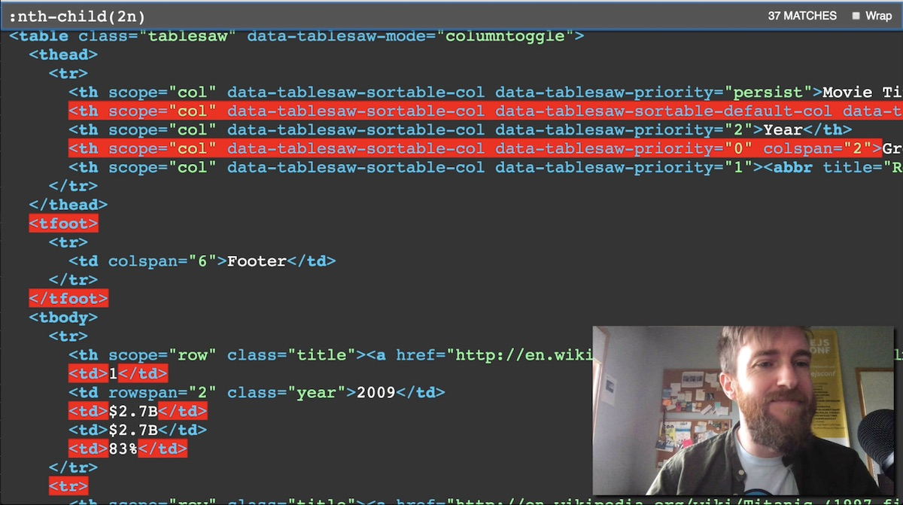

# selecthor

A proof of concept project to show a way to test, learn, and demo CSS Selectors.

## Live Demo

[https://www.zachleat.com/selecthor/](https://www.zachleat.com/selecthor/)

## Intro Video

 [https://www.youtube.com/watch?v=CwZniQc0zg0](https://www.youtube.com/watch?v=CwZniQc0zg0)
